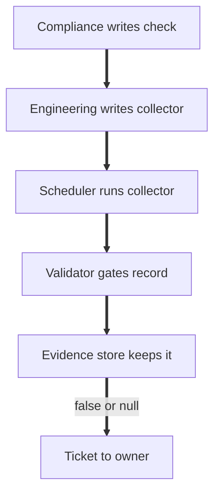

# ksi-evidence-schema

A sanitized model of how I structure evidence for FedRAMP 20x Key Security Indicators (KSIs) so it can be validated automatically as true / false / null instead of read as a narrative.

Everything here is derived from the public [FedRAMP Consolidated Rules for 2026](https://www.fedramp.gov/2026/). Nothing from any employer's environment or repositories is included.

**Who this is for:** compliance SMEs who own FedRAMP 20x KSIs, and the engineers they hand checks to.

If you do not write code, start with [docs/handoff-walkthrough.md](docs/handoff-walkthrough.md).



## What is in here

```
schema/ksi-evidence.schema.json   JSON Schema (draft 2020-12) for one KSI evidence record
samples/                          Three records: one pass, one fail, one null
validate.py                       Validates every record against the schema, prints a table, non-zero exit on bad records
checks/                           One check definition per KSI, plus the schema for check definitions
collector.py                      Reference collector: check definition in, one evidence record out
docs/                             Guides for compliance SMEs: handoff walkthrough, writing a check, glossary, review checklist
terraform/example.tf              How a record can be emitted straight from Terraform state
```

## Handing this to an engineering team

1. Compliance writes the check in `checks/`: the query, the interval, and the `pass_when` rule that decides true, false or null. The rule is a FedRAMP interpretation, so compliance owns it.
2. Engineering writes the collector for their system: the fetch that runs the query and returns the raw response. `collector.py` shows the shape; only the fetch function changes.
3. A scheduler runs each collector on the check's `collect.interval`. A fetch that errors or times out still produces a record, with `result: null`.
4. Every record is validated against `schema/ksi-evidence.schema.json` and written to the evidence store with its collection timestamp.
5. A record with `result: false` or `result: null` opens a ticket to the check's `owner`, carrying the rendered rationale.
6. A deviation (an accepted risk, a pending change) is never edited into an evidence record. It is a separate record, reviewed and approved on its own, that points at the evidence it explains.

See `checks/README.md` for the collector contract.

## The record

Each record answers one question about one KSI: did the evidence show it was met at the time it was collected?

| Field | Why it is there |
|---|---|
| `ksi_id`, `statement` | The KSI, with its statement copied verbatim from fedramp.gov so a reviewer does not need to cross-reference. |
| `class` | 20x Class A, B or C. The same KSI can carry different expectations by class. |
| `evidence_type` | `api_query`, `config_export`, `log_query`, or `manual`. Automated types are the default; `manual` is the exception and should be visible as one. |
| `source` | What system was queried and the exact query, so the evidence can be re-collected. Optional hash and URI of the raw artifact. |
| `collected_at` | When. Evidence is a point-in-time claim. |
| `result` | `true`, `false`, or `null`. |
| `rationale` | Required whenever `result` is `false` or `null`. A short, reviewer-facing reason. |
| `owner` | Accountable role, not a person. |
| `related_800_53_controls` | The SP 800-53 mappings FedRAMP publishes for the KSI, for crosswalk back to Rev5 packages. |

## Why true/false records instead of narratives

FedRAMP 20x expects KSIs to be validated persistently and, wherever possible, automatically. A paragraph describing how MFA is configured cannot be re-checked by a pipeline tomorrow morning. A record that says "I ran this query against this system at this time and the condition held" can be. The narrative becomes the `rationale` field, and it only has to exist when something is wrong.

## The null result is a finding, not a skip

The third sample, `ksi-mla-osm-null.json`, is the one I care most about. The SIEM query failed, so no evidence was collected. The tempting shortcut is to leave the record out or mark it "not applicable this cycle." The schema forces a `rationale` on every `null` and the validator counts nulls alongside fails.

That is deliberate. CR26 rule [VDR-CSO-FAV](https://www.fedramp.gov/2026/reference/vulnerability-detection-and-response/) requires providers to treat problems or failures with their own detection and response processes as vulnerabilities. A monitoring check that cannot run is a vulnerability in the monitoring, and it should enter the same lifecycle as any other finding.

## Run it

```bash
pip install -r requirements.txt
python validate.py
```

Output:

```
KSI          RESULT  VALID  RATIONALE
-------------------------------------
KSI-IAM-APM  PASS    yes    All 4 authentication policies in scope enforce phishing-resistant MFA (FIDO2 or PIV). No exceptions or legacy factors found.
KSI-MLA-OSM  NULL    yes    SIEM search API returned HTTP 503 for the full collection window. No evidence could be gathered. Treated as a finding under VDR-CSO-FAV ...
KSI-PIY-GIV  FAIL    yes    Cloud API reports 11 compute instances not present in IaC state. No change ticket or exception explains them. ...

3 records, 0 schema-invalid, 2 with result false or null
```

`validate.py` exits non-zero only when a record is malformed. Whether the KSIs themselves pass is reported, not enforced, because that decision belongs to the compliance workflow, not the linter.

Pass your own files: `python validate.py path/to/*.json`

## Terraform example

`terraform/example.tf` shows the record being produced as a byproduct of the deployment rather than written after the fact. A `check` block asserts the KSI-IAM-APM condition on every plan, and the rendered record is written out for `validate.py` to pick up. It uses the `null` provider so it plans without credentials:

```bash
cd terraform && terraform init && terraform plan
```

Change `allowed_factors` to include `"sms"` and the check fails and the record flips to `result: false` with the reason filled in.

## What is deliberately left out

- Any provider-specific resource names, API endpoints, realm or tenancy identifiers, or environment labels.
- The full KSI catalog. Three indicators are enough to show the shape; filling in the other 40-plus is data entry.
- The upstream architecture this is a slice of: a sample internal repository design and the automation that feeds it live in a private employer environment and are not reproducible here.

## References

- [FedRAMP Key Security Indicators (CR26 reference)](https://www.fedramp.gov/2026/reference/key-security-indicators/)
- [FedRAMP Vulnerability Detection and Response rules](https://www.fedramp.gov/2026/reference/vulnerability-detection-and-response/)
- [FedRAMP Consolidated Rules for 2026](https://www.fedramp.gov/2026/)

### Keeping KSI text current

The `statement` and `related_800_53_controls` fields in `samples/` and `checks/` are synced from the machine-readable rules in [FedRAMP/rules](https://github.com/FedRAMP/rules) (`fedramp-consolidated-rules.json`). `upstream.lock` records the upstream commit they were last synced against.

- CI runs `python tools/sync_ksi.py --check` and fails if our text or control mappings have drifted from upstream.
- A weekly job (`.github/workflows/ksi-sync.yml`, Mondays 06:00 UTC) runs `tools/sync_ksi.py --write` and opens a PR labeled `upstream-change` when upstream has changed.
- A human reviews that PR before merging. A changed statement can invalidate a check's `pass_when` rule, so the check logic must be reread against the new text, not just the wording accepted.

## License

MIT. See `LICENSE`.
